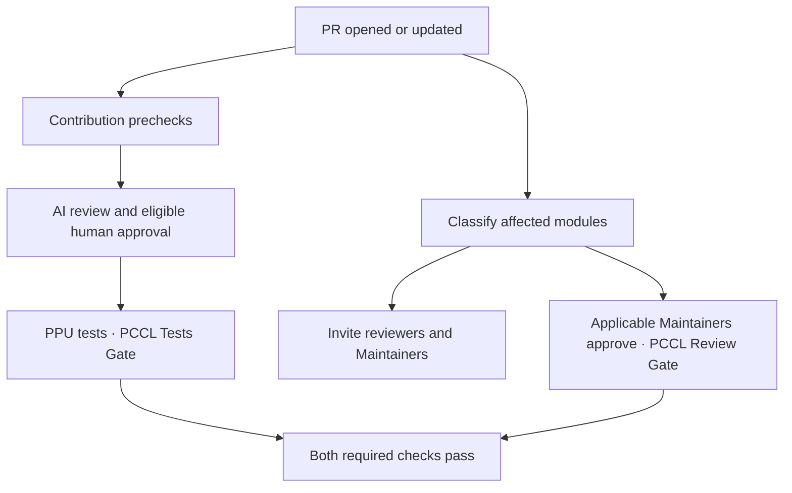

# GitHub workflows

Opening or updating a ready PR starts checkin and module review independently.

[Checkin](workflows/pr-test-ppu.yml) accepts an approval from an eligible reviewer with repository
write access and runs the [PPU test matrix](workflows/scripts/casecmd.list). `PCCL Tests Gate`
summarizes the CI results.

[Reviewer routing](workflows/reviewer-routing.yml) uses the [module classification skill](skills/pccl-review-assignment/SKILL.md)
to identify affected modules. It rotates reviewers per module and invites each selected reviewer
and applicable Maintainer once. The `workflow/review` branch stores the classification and assigned
IDs so retries reuse the same people. Limit writes to trusted automation and authorized maintainers.

To retry classification, run **Recommend PCCL reviewers** on `main` with the PR number.
If the diff is too large, binary or incomplete, routing reports the problem and sends no invitations.

[Module approval](workflows/maintainer-approval.yml) publishes `PCCL Review Gate` when all applicable
module Maintainers have approved the current commit. A Lead Maintainer approval covers every module,
including when AI cannot classify the diff. A Maintainer author is exempt for their own module.
An approval still counts if the invitation failed. Review submissions, edits and dismissals refresh
the gate through a read-only [review notification](workflows/review-event.yml), including for fork PRs.

Keep `PCCL Tests Gate` required. Once `PCCL Review Gate` has succeeded on a real PR after deployment,
add it to the target branch's required checks. The PR must carry the deployed review notification
so that withdrawing an approval refreshes the gate. Sync it to release branches. To replace the
notification itself, deploy its successor at a new path before retiring the original.
