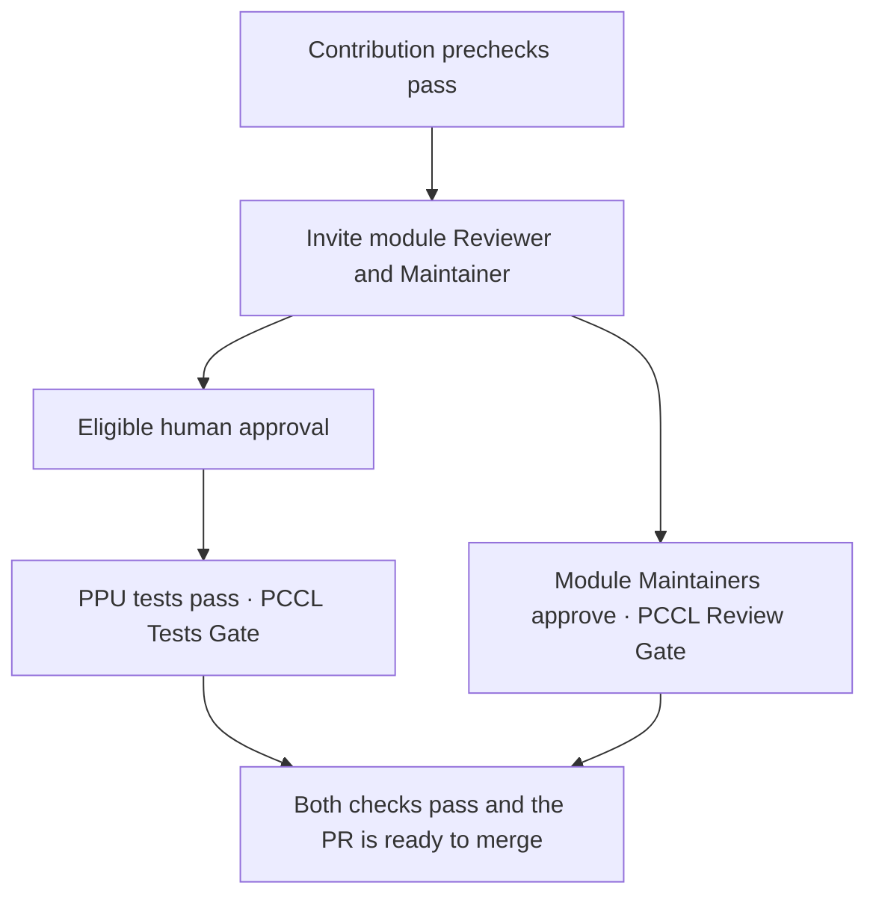

# GitHub workflows

[Checkin](workflows/pr-test-ppu.yml) runs contribution checks, the organization’s AI and human
review gates, and PPU builds and tests. `PCCL Tests Gate` summarizes their results.
The [test list](workflows/scripts/casecmd.list) defines the PPU matrix.

[Reviewer routing](workflows/reviewer-routing.yml) waits for Secret Scan and Commit Message & DCO
on the current PR revision before classifying modules and inviting reviewers. Copilot uses the
[module catalog and classification rules](skills/pccl-review-assignment/). The workflow rotates
reviewers per module and also invites its Maintainer. The `workflow/review` branch stores the
rotation and PR assignments so updates and retries keep the same people. Limit writes to this
branch to trusted automation and authorized maintainers.

When classification needs a human decision, the Lead Maintainer can run **Recommend PCCL reviewers**
from `main`, entering the PR number and comma-separated module IDs. The same prechecks and invitation
rules apply. Successful invitations publish `PCCL Reviewer Invitations` on the tested merge revision.

## Independent merge checks

After invitations, checkin accepts an approval from any eligible reviewer with repository write
access and runs the PPU tests. In parallel, [Maintainer approval](workflows/maintainer-approval.yml)
checks the current PR revision against its affected modules. Each applicable module Maintainer
must approve, or the Lead Maintainer can cover all modules. A Maintainer author is exempt for their
own module. An earlier approval for the same commit can satisfy both roles.

Keep `PCCL Tests Gate` required. After the approval workflow is on `main` and has published
`PCCL Review Gate` on a real PR, add that check to the target branch rules as well.
Review submissions, edits and dismissals refresh the approval check. Fork review events use a
read-only notification, which must be present on the target branch when rolling out to release.
