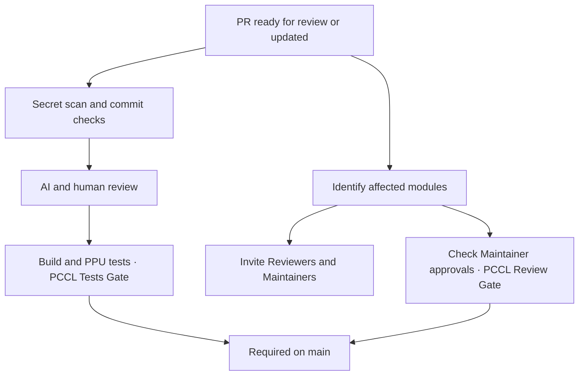

# GitHub workflows

CI and module review run independently. PRs targeting `main` must pass both PCCL checks.

1. [PCCL Tests Gate](#pccl-tests-gate) summarizes contribution checks, builds and PPU tests.
2. [PCCL Review Gate](#pccl-review-gate) checks Maintainer approvals for the affected modules.

## PCCL Tests Gate

| File | Purpose |
| --- | --- |
| [pr-test-ppu.yml](workflows/pr-test-ppu.yml) | Run contribution checks, AI and human review, builds and PPU tests; report `PCCL Tests Gate`. |
| [workflows/scripts/](workflows/scripts/) | Build and test helpers for PCCL and `pccl-tests`. |
| [casecmd.list](workflows/scripts/casecmd.list) | Define the PPU test matrix. |

## PCCL Review Gate

| File | Purpose |
| --- | --- |
| [reviewer-routing.yml](workflows/reviewer-routing.yml) | Classify affected modules and invite Reviewers and Maintainers. |
| [maintainer-approval.yml](workflows/maintainer-approval.yml) | Refresh `PCCL Review Gate` from module approval results. |
| [review-event.yml](workflows/review-event.yml) | Notify the approval workflow when a Review changes. |
| [Classification Skill](skills/pccl-review-assignment/SKILL.md) | Define the module classification criteria. |
| [modules.json](skills/pccl-review-assignment/modules.json) | Define module scopes, Reviewers and Maintainers. |
| [review_automation.py](scripts/review_automation.py) | Classify modules, select Reviewers, and send invitations and notifications. |
| [reviewer_state.py](scripts/reviewer_state.py) | Store classification, assignments and rotation on `workflow/review`. |
| [reviewer_api.py](scripts/reviewer_api.py) | Provide GitHub API helpers. |
| [maintainer_approval.py](scripts/maintainer_approval.py) | Evaluate module Maintainer approvals for the current PR version. |

---

